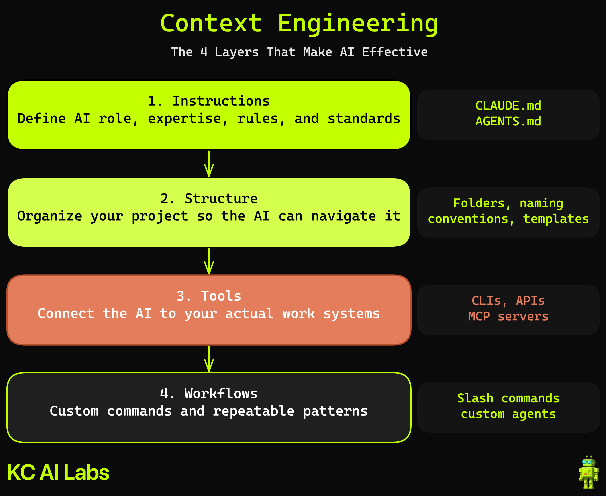

# Practical AI Playbook Workshop

Public context-engineering materials for the AZ Tech Week workshop on April 8, 2026, and [the related tutorial](https://youtu.be/euj9jLBM140).

## Reuse the context examples

- [CLAUDE.md starter](context_examples/CLAUDE_md_starter.md)
- [Agents and skills starter](context_examples/agents_and_skills_starter.md)

The editable source is `images/context_engineering_framework.excalidraw`.

The Notion reporting application discussed in the tutorial is maintained in [Channel Patterns Analyzer](https://github.com/kyle-chalmers/channel-patterns-analyzer). For the current reusable agent tools, see the [skills collection](../../skills/).

Migrated November 17, 2026. Personal LinkedIn exports, private datasets and presentation preparation notes are excluded. Bring your own appropriately shared example data when adapting the exercises.
